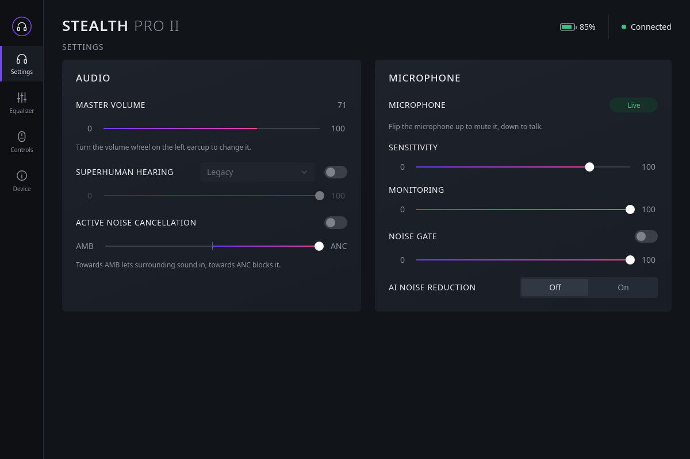
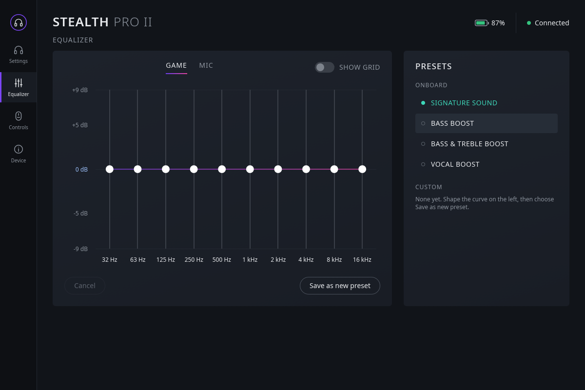
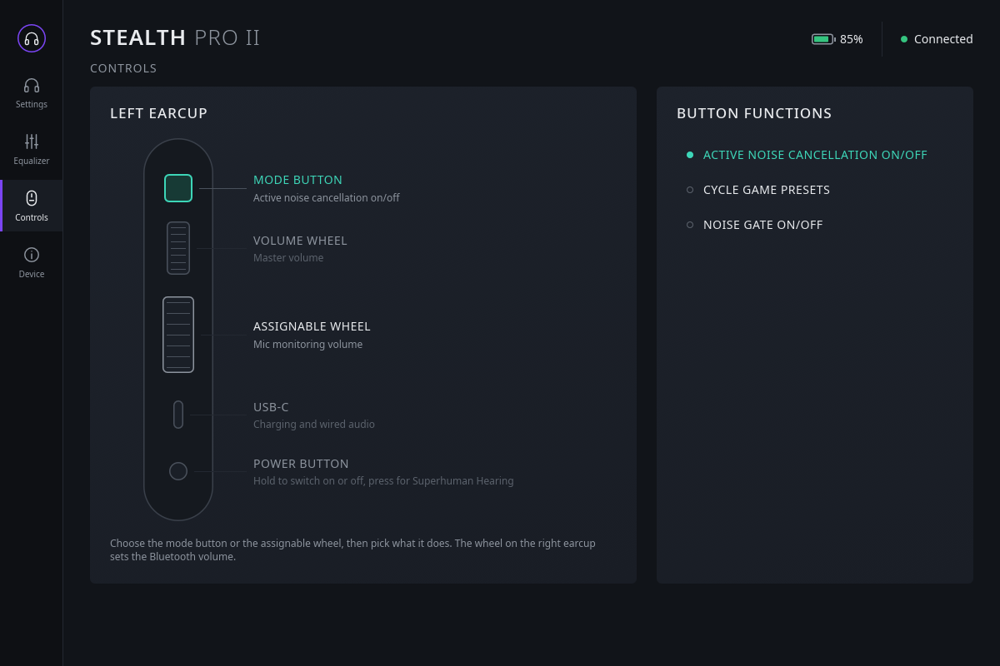
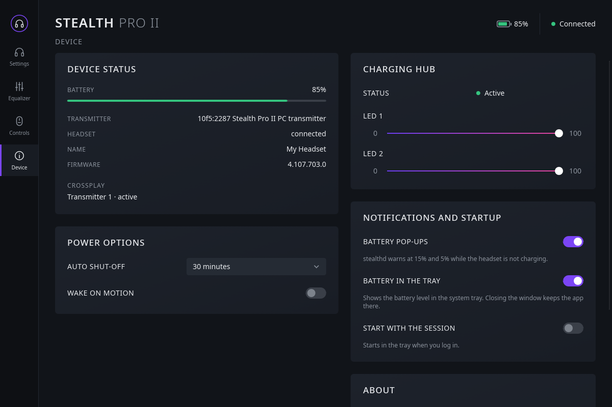
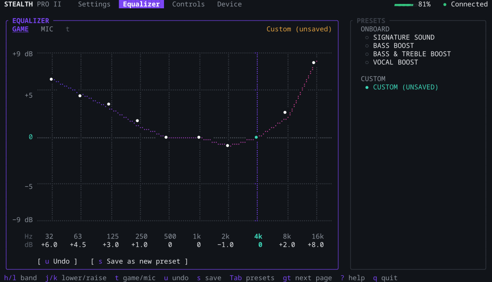
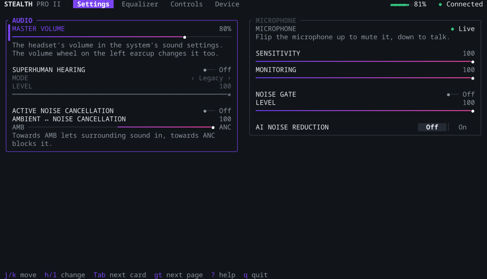

> [!CAUTION]
> **This project is 100% AI-generated. It is AI slop that no human has reviewed.**
>
> Every line of code, every script and every word of documentation in this repository, this README included, was
> written by an AI (Anthropic's Claude). No human has read or reviewed any of it. The only human involvement was
> trying the app out on one Stealth Pro II under Fedora and KDE Plasma and saying "seems to work". The headset
> protocol was reverse-engineered by the same AI, so the app changes settings on your headset in ways the
> manufacturer never documented. There is no warranty of any kind: use it at your own risk, and read the code
> before you trust it.

# swarm2linux

A Linux replacement for Turtle Beach's Swarm II app, starting with the **Stealth Pro II** headset.

This is an independent interoperability project and is not affiliated with Turtle Beach.

| Settings | Equalizer |
|---|---|
|  |  |
| **Controls** | **Device** |
|  |  |

## Installation

You need Linux with a systemd user session and PipeWire, such as Fedora, Ubuntu, Debian, Arch or openSUSE with
KDE Plasma or GNOME, and the headset's USB transmitter (or its USB-C cable).

```sh
git clone https://github.com/tbt9czsdd4-droid/swarm2linux.git
cd swarm2linux
./install.sh
```

The script installs everything for your user and asks before it changes anything outside your home folder:

1. **Build tools.** If they are missing, it installs a C compiler, pkg-config and the fontconfig headers with dnf, apt,
   pacman or zypper.
2. **Rust.** If Rust 1.92 or newer is missing, it installs it into `~/.cargo` with [rustup](https://rustup.rs).
3. **Headset access.** It installs the udev rule `/etc/udev/rules.d/70-swarm2linux.rules`, so your user can open
   the headset. This step needs your sudo password.
4. **Build.** It builds everything, which takes a few minutes the first time.
5. **Install.** It puts the programs into `~/.local/bin`: `stealth-gui` (the desktop app), `stealth-tui` (the
   terminal app), `stealthd` (the background service) and `stealthctl` (the command line tool). It adds the
   **swarm2linux** entry to the app menu and starts `stealthd` now and with every login.

Then open **swarm2linux** from the app menu, or run `stealth-tui` in a terminal. If you want the tray icon after
login, turn on **Start with the session** on the desktop app's Device page.

| Task | Command |
|---|---|
| Update | `git pull && ./install.sh` |
| Uninstall | `./install.sh --uninstall` |
| Answer yes to every question | `./install.sh --yes` |
| Leave the udev rule alone | `./install.sh --no-udev` |

Uninstalling removes the programs, the menu entry, the service, the autostart entry and the udev rule. It keeps
your app preferences in `~/.config/swarm2linux`, and it leaves Rust installed. The headset keeps its settings,
because they are stored on the headset.

The script was tested on Fedora 44 with KDE Plasma, and on clean Fedora 44 and Ubuntu 24.04 containers. It does
not support immutable systems such as Bazzite, Fedora Kinoite or Silverblue, and SteamOS yet: those can't install
the build tools with a normal package manager.

### Troubleshooting

- **The app says "stealthd is not running".** Check the service with `systemctl --user status stealthd`; its log
  is `journalctl --user -u stealthd`.
- **The headset is not found.** `stealthctl devices` lists what is plugged in. After installing the udev rule,
  unplug the transmitter and plug it in again.
- **No tray icon on GNOME.** GNOME needs the "AppIndicator and KStatusNotifierItem Support" extension.

## Status

Version 1.2. The desktop app `stealth-gui` covers the same settings as Swarm II's pages, with a tray icon for the
battery, and the terminal app `stealth-tui` has the same pages with vim keys.
`stealthctl` reads all 26 records and changes both EQs (presets, bands, saving and deleting custom presets), Superhuman Hearing, ANC, mic monitoring, noise gate, sensitivity and AI noise reduction. It also sets the button and wheel functions, auto shut-off, wake on motion and the charging hub LEDs; that covers every headset setting Swarm II offers on PC except the master-volume mute toggle. See [docs/PLAN.md](docs/PLAN.md) for the roadmap and
[docs/protocol.md](docs/protocol.md) for what is known about the protocol.

## How it works

On Linux, audio already works through `snd-usb-audio`: the transmitter is a standard USB Audio Class 1 device.
All headset settings (EQ, ANC, mic, sidetone, buttons) live on the headset and the transmitter and are changed over
a vendor HID collection (usage page `0xFF13`). That collection carries Airoha RACE packets, and Turtle Beach
tunnels a JSON key/value protocol through them. This project speaks that protocol from Linux.

## Supported hardware

| USB ID      | Device                                   |
|-------------|------------------------------------------|
| `10f5:2287` | Stealth Pro II PC, USB-A transmitter     |
| `10f5:229b` | Stealth Pro II transmitter dock          |
| `10f5:2289` | Stealth Pro II PC headset on its USB-C cable (seen) |
| `10f5:229e` | Stealth Pro II headset on its USB-C cable (other SKU, from HaloBattery) |

## stealth-gui (desktop app)

A Slint app in the style of Swarm II, with four pages:

- **Settings:** master volume, Superhuman Hearing (mode and level), noise cancellation (ambient to full), and the
  microphone (sensitivity, monitoring, noise gate, AI noise reduction). The master volume is the headset's volume
  in the system's sound settings, the one KDE and the volume wheel change.
- **Equalizer:** game and mic EQ as a draggable 10-band graph, the onboard presets, and saving and deleting custom
  presets.
- **Controls:** what the mode button and the assignable wheel do.
- **Device:** battery, transmitters and firmware, auto shut-off and wake on motion, the charging hub's LEDs,
  battery pop-ups, the tray icon and starting with the session.

It is a client of `stealthd` and needs it running. The tray icon shows the battery as a headset whose ear cups
fill up; its menu switches noise cancellation, Superhuman Hearing and the game EQ preset. Closing the window keeps
the app in the tray (turn the tray off on the Device page to quit on close), and `stealth-gui --hidden` starts in
the tray.

Built with [Slint](https://slint.dev) under its royalty-free licence; the Device page carries the credit.

## stealth-tui (terminal app)

| Equalizer | Settings |
|---|---|
|  |  |

The same four pages as the desktop app in a terminal, built with [ratatui](https://ratatui.rs). Like the desktop app
it is a client of `stealthd` and needs it running. It works with vim keys, the arrow keys and the mouse; `?` shows
every key.

| Keys | Action |
|---|---|
| `j` `k` / `↓` `↑` | next / previous control; with a count, `3j` |
| `h` `l` / `←` `→` | change by one: a slider, the option, off / on (`5l` changes by five) |
| `H` `L` / `Shift-←` `Shift-→` | change by ten |
| `0` `$` | minimum / maximum (`$` does not apply to the master volume) |
| `gg` `G` / `Home` `End` | first / last control |
| `Enter` `Space` | toggle, or open the options |
| `Tab` `Shift-Tab` | next / previous card |
| `gt` `gT` / `]` `[` | next / previous page; `2gt` goes to page 2 |
| `q` `:q` `Ctrl-c` | quit |

On the Equalizer graph, `h` `l` choose a band and `k` `j` raise and lower it by 0.5 dB (`K` `J` by 3 dB); `=` sets it
to 0 dB, `t` switches between the game and mic EQ, `u` undoes the changes and `s` saves them as a new preset. In the
preset list, `Enter` chooses a preset and `dd` deletes a custom one.

The mouse works too: click tabs, controls, options and presets, click or drag sliders and EQ bands, and turn the
wheel over a slider or band. Sliders and bands are written to the headset once they have rested for 300 ms, so
holding a key down does not flood it. The terminal needs to be at least 80×24; from 100 columns on, the cards sit
in two columns. Colours use truecolor when `COLORTERM` says the terminal has it, otherwise 256 colours.

## stealthd (background service)

`stealthd` owns the headset: it finds it (preferring the transmitter over the headset's own cable), keeps a session
with every record subscribed, follows unplugging, and serves everything on the session bus. It also shows a
notification when the battery drops to 15 % and 5 % (the `BatteryNotifications` property turns that off; it is
kept in `~/.config/swarm2linux/stealthd.toml`). `install.sh` runs it as the systemd user service `stealthd`.

After a restart the headset can keep AI noise reduction working while it reports it off. Whenever `stealthd`
connects to the headset and finds it reported off, it switches it on and off once, which ends that.

The headset's volume belongs to PipeWire: the headset reports it but takes no writes for it. So `stealthd` finds
the headset's sound output in PipeWire (with `pw-dump`), serves its volume in percent as `sink_volume`, and sets
it with `wpctl`. Without those two tools, the volume is shown but can't be changed.

D-Bus: `io.github.swarm2linux.Stealthd`, object `/io/github/swarm2linux/Headset`, interface
`io.github.swarm2linux.Headset1` with `Values() -> a{sv}`, `Set(s, v)`, `SetBand(s, u, i)`, `SavePreset(s, s)`,
`DeletePreset(s, s)` and the signal `Changed(a{sv})`. Value names are listed in `crates/tb-proto/src/values.rs`,
plus `connected`, `device`, `headset_link` and `sink_volume` from the daemon.

```sh
busctl --user call io.github.swarm2linux.Stealthd /io/github/swarm2linux/Headset \
    io.github.swarm2linux.Headset1 Set sv anc b true
```

When `stealthd` runs, `stealthctl` goes through it; the raw commands (`dump`, `get`, `set`, `snapshot`, `restore`)
need direct access and ask you to stop the service first.

## stealthctl

```sh
stealthctl status                 # battery, transmitters, volume, both EQs, Superhuman Hearing, ANC, mic
stealthctl volume 40              # the headset's volume in the system's sound settings, 0-100
stealthctl eq list                # game EQ: bands with frequencies, built-in and custom presets
stealthctl eq preset bass         # signature | bass | bass-treble | vocal | <custom preset name>
stealthctl eq band 1 -3.5         # dB in steps of 0.5
stealthctl eq save MyPreset       # save the current bands as a custom preset (5 slots); eq delete MyPreset
stealthctl mic-eq preset clarity  # signature | full | clarity | smooth; band/save/delete as for eq
stealthctl shh on                 # Superhuman Hearing; off, mode legacy|footsteps|gunshots, level 0-100
stealthctl anc on                 # off, level 0-100 (0 = ambient, 100 = full noise cancellation)
stealthctl monitor level 60       # how loud you hear your own voice
stealthctl mic gate on            # mic: sensitivity N, gate on|off, gate-level N, ai on|off
stealthctl button cycle-eq        # top left button: anc | cycle-eq | noise-gate
stealthctl wheel chat-mix         # assignable wheel: monitoring | chat-mix | bass | treble | noise-gate
stealthctl power auto-off 20      # never | 5 | 10 | 20 | 30; power wake-on-motion on|off
stealthctl hub led1 30            # charging hub LED brightness: led1 | led2 0-100
stealthctl watch                  # print changes as they happen (buttons, wheel, battery, CrossPlay)
stealthctl snapshot my.json       # save everything; `restore my.json` writes the settings back
stealthctl dump                   # every record as JSON
```

Set `RACE_HID_TRACE=1` to print every HID report.

## Reverse-engineering tools

`tools/re/` holds dependency-free Python scripts that talk to `/dev/hidrawN` directly:

```sh
python3 tools/re/probe.py            # read-only: open a session and dump the device state
python3 tools/re/monitor.py --session  # log every packet the device pushes (survives replugging)
python3 tools/re/decode_log.py --changes captures/linux/monitor-*.jsonl  # replay a saved log
python3 tools/re/pcap2jsonl.py capture.pcapng -o capture.jsonl  # Windows USBPcap capture -> same log format
python3 tools/re/kvp.py dump --save    # read all 26 records, save a snapshot
python3 tools/re/kvp.py watch 60       # subscribe to everything and print pushed changes
python3 tools/re/kvp.py set 0x1210 2   # write a key (only keys/values Swarm II was seen writing)
```

The hidraw node must be readable and writable by your user. `install.sh` installs `packaging/70-swarm2linux.rules`
for that.

## Safety

The tools only send frames that Turtle Beach's own app has been observed sending. They never send RACE storage
(`0x04xx`) or firmware-update (`0x1Cxx`) commands. Firmware updates are out of scope; use the official mobile app.

## License

MIT, see [LICENSE](LICENSE). The app is built with [Slint](https://slint.dev), which it uses under the Slint
Royalty-free Desktop, Mobile, and Web Applications License; that licence asks for the "Made with Slint" credit on
the app's Device page.
